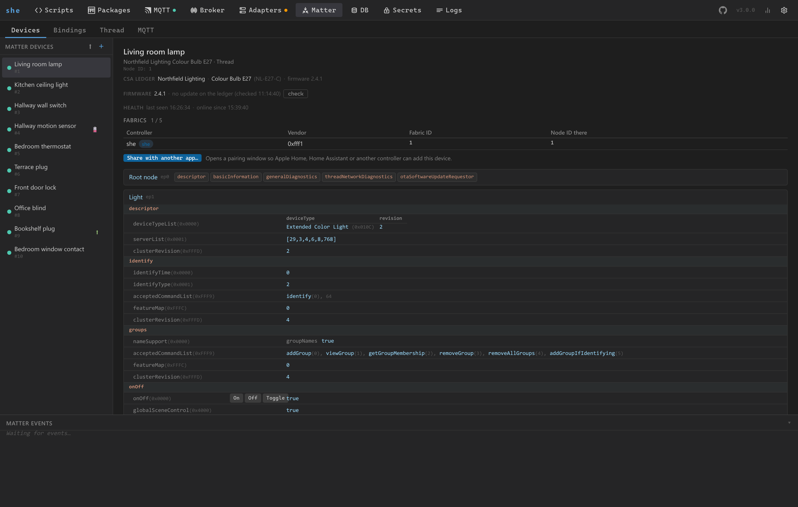
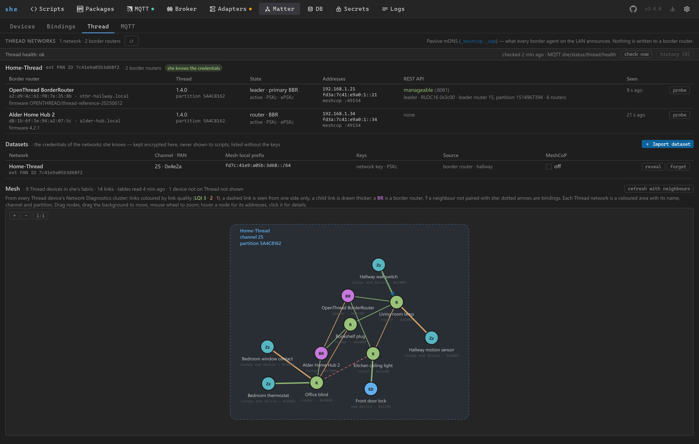

# Matter

she has a Matter controller built in. It pairs Matter devices, keeps a live copy of their state, and hands them to
your scripts as `she.matter.*` — next to MQTT, in the same script. This guide goes from a fresh installation to a
script that reacts to a Matter device.

- [Nothing to install](#nothing-to-install)
- [Switch the controller on](#switch-the-controller-on)
- [Pair a device](#pair-a-device)
- [Thread devices](#thread-devices)
- [Check that it works](#check-that-it-works)
- [Read a value: `she.matter.get()`](#read-a-value-shematterget)
- [React to a device: `she.matter.sub()`](#react-to-a-device-shemattersub)
- [Control a device: `she.matter.send()`](#control-a-device-shemattersend)
- [The rest of the Matter page](#the-rest-of-the-matter-page)
- [Troubleshooting](#troubleshooting)

## Nothing to install

The controller is [matter.js](https://github.com/matter-js/matter.js), a dependency of she. There is no chip-tool, no
second service and no Python environment to set up: installing she (see [Getting started](getting-started.md)) is all
it takes.

What the host needs:

- **The same network as the devices.** Matter finds devices with mDNS and talks to them over IPv6 (and IPv4), so she
  has to sit on the LAN the devices are on, with multicast reaching it.
- **Docker: host networking.** mDNS does not pass Docker's bridge network; run the container with `--network host`
  (which does not combine with `-p`).

## Switch the controller on

The controller is **off until you enable it** — it is the one switch there is:

1. Open **Config → Matter controller** and tick **Enable**.
2. Leave **Storage path** empty to use the default, or enter a directory.
3. Save and restart she. The **Matter** page appears in the navigation.

The same without the web UI — in the config file, `true` for the default directory or a path; on the command line,
a path (see [CLI](cli.md)):

```json
{ "matterStorage": true }
```

```bash
she --matter-storage /opt/she/matter
```

**The storage directory** is `<data-dir>/matter` by default: `~/.she/matter`, or `/var/lib/she/matter` in the Docker
image. It holds she's fabric (the controller's identity and keys) and the paired devices, plus she's own files next to
them (`device-health.json`, `fabric-lost.json`, `mqtt-bridge.json`, `groups.enc`, `thread-datasets.enc`). **Back it
up**: without it every device has to be paired again. Scripts start only once the controller is up (or after 30 seconds
at the latest), so `she.matter.*` can be used at the top level of a script.

## Pair a device

Open the **Matter** page. The **Devices** tab lists the paired devices on the left; **＋** above the list opens the
pairing form.



The form has two modes:

| Mode | What you enter |
|---|---|
| **QR / Code** | The 11-digit pairing code printed on the device or shown by another app (`2477-500-3245`), or the content of the QR code (`MT:…`). **Camera** scans the QR code with the browser's camera, **Image…** decodes it from a picture. |
| **Passcode** | The setup **Passcode** and, optionally, the **Discriminator** — for devices and tools that show these two numbers instead of a code. |

**IP Address (optional, bypasses mDNS)** connects straight to a device (`192.168.1.100` or `192.168.1.100:5540`) when
discovery does not find it.

**Commission** starts the pairing. It can take a minute; she gives up after 120 seconds with a message. The device
then appears in the list, its dot showing that it is online, and the Logs page shows `matter: commissioning succeeded, nodeId …`.

### A new device, or one that is already in another app?

she pairs devices **over the IP network**: the device has to be on your Wi-Fi, Ethernet or Thread network already.
she has no Bluetooth pairing, which is what a factory-new Wi-Fi or Thread device needs to learn its network.

- **A device already on the network** (Ethernet devices, bridges, a device in pairing mode on Wi-Fi): enter its
  pairing code as above.
- **A device in Apple Home, Google Home, Home Assistant or another app**: leave it there and share it. Matter devices
  can belong to several controllers at once (multi-admin). In the other app, turn on the device's pairing mode — it
  shows a new pairing code and often a QR code — and enter that code in she's **QR / Code** field. The device then
  works in both. This is also the way for a factory-new Wi-Fi or Thread device: pair it with the phone app first,
  then share it into she.

It works the other way round, too: every paired device has a **Fabrics** panel that lists the controllers the device
belongs to, and **Share with another app…** opens a 15-minute pairing window with a QR code and a manual code for the
other app. The device stays in she.

### Names

A device is listed under its label (`nodeLabel`) or, without one, its product name; its node ID is shown next to it.
Right-click a device → **Rename…** writes a new label to the device (32 characters at most). Scripts address a device
by this name or by its node ID, so give your devices names you want to read in a script.

## Thread devices

Thread devices have no Wi-Fi: they form their own mesh, and a **Thread border router** connects that mesh to your LAN.
Without one on the LAN, she cannot reach a Thread device. Apple TV and HomePod, Google Nest hubs and OpenThread
border routers (OTBR) are border routers. Pair the Thread device with the app that belongs to the border router, then
share it into she as described above.

The **Thread** tab shows what she sees of this — it only listens, nothing is written to a border router:



- **Thread networks** — every network a border router announces on the LAN, with its border routers. If the list
  stays empty, no border router is visible from she's host; discovery is passive, so give it a minute.
- **Thread health** — alerts for a changed leader, a partitioned network, a border router that stopped announcing
  itself, a router that dropped to a child, and a link that degraded. They are also published retained on
  `<name>/status/thread/health` (`she/status/thread/health` by default).
- The **mesh** as a graph, read from the paired Thread devices: routers, end devices and the quality of the links.
- The **network credentials** (datasets) she knows, stored encrypted — optional, and not needed to pair or use a
  device.

**IPv6 routes on Linux.** A border router announces the route into its Thread mesh with IPv6 router advertisements.
Linux ignores such routes by default, and a Thread device then stays offline in she although the border router is
fine. On a host that configures its network through the kernel, allow them for the LAN interface (here `eth0`):

```bash
sysctl -w net.ipv6.conf.eth0.accept_ra=2
sysctl -w net.ipv6.conf.eth0.accept_ra_rt_info_max_plen=64
```

Put both into `/etc/sysctl.d/` to keep them across reboots. `ip -6 route` then lists a route to the mesh's prefix via
the border router.

## Check that it works

On the **Devices** tab, click the device. The page shows its endpoints, and per endpoint the clusters with their
attributes and current values — an on/off plug has an endpoint `1` with a cluster `onOff` and an attribute `onOff`.
Common attributes have buttons (**On**, **Off**, **Toggle**), so you can switch the device from here.

**The names on this page are the names scripts use**: the endpoint number, the cluster name and the attribute name,
exactly as written. The **Matter Events** feed at the bottom shows every attribute change (`attr`), every cluster
event such as a button press (`event`) and every online/offline change (`status`) as it comes in — operate the
device and watch what it reports before you write a script.

## Read a value: `she.matter.get()`

`she.matter.get(nodeId, endpointId, clusterName, attrName)` returns a Promise for the attribute's current value. Put
this into a new script on the **Scripts** page and save it:

```js
she.matter
    .get('living-room-plug', 1, 'onOff', 'onOff')
    .then((on) => she.log('living-room-plug is', on ? 'on' : 'off'))
    .catch((err) => she.error('living-room-plug:', err.message));
```

The script log shows `living-room-plug is on`. If it shows `Matter node not found: living-room-plug`, the name does
not match — use the name from the device list, or the node ID (`she.matter.get(3, 1, 'onOff', 'onOff')`).

- `nodeId` — the node ID, or the device's name.
- `endpointId` — the endpoint number, or the endpoint's name (useful for the devices behind a Matter bridge).
- `clusterName`, `attrName` — camelCase, as on the Devices tab.

Top-level `await` is not available in scripts; use `.then()` as above, or `await` inside an `async` function or a
callback.

## React to a device: `she.matter.sub()`

`she.matter.sub(nodeId, endpointId, clusterName, attrName, callback)` calls `callback(value, oldValue)` whenever the
attribute changes:

```js
// mirror a Matter plug's state to an MQTT topic
she.matter.sub('living-room-plug', 1, 'onOff', 'onOff', (on) => {
    she.log('living-room-plug switched', on ? 'on' : 'off');
    she.mqtt.pub('home/status/living-room-plug', on, { retain: true, status: true });
});
```

**Events.** Buttons do not change an attribute, they send events. Name the event instead of an attribute, and the
callback gets the event's payload and, as second argument, `{ event: true, cluster, name, ts }`:

```js
// a Matter button: double press switches an MQTT light on, long press switches it off
she.matter.sub('hallway-button', 1, 'switch', 'multiPressComplete', (ev) => {
    if (ev.totalNumberOfPressesCounted === 2) she.mqtt.pub('home/set/hallway-light', true);
});
she.matter.sub('hallway-button', 1, 'switch', 'longPress', () => {
    she.mqtt.pub('home/set/hallway-light', false);
});
```

Which events a button sends (`initialPress`, `shortRelease`, `longPress`, `longRelease`, `multiPressOngoing`,
`multiPressComplete`) depends on the device — press it and read the names from the Matter Events feed.

`she.matter.sub()` returns a listener ID for `she.matter.unsub(id)`. Subscriptions are removed when the script is
reloaded, so there is nothing to clean up.

## Control a device: `she.matter.send()`

`she.matter.send(nodeId, endpointId, clusterName, command, [args])` invokes a command and returns a Promise:

```js
// an MQTT topic switches a Matter plug
she.mqtt.sub('home/set/living-room-plug', (topic, val) => {
    she.matter
        .send('living-room-plug', 1, 'onOff', val ? 'on' : 'off')
        .catch((err) => she.warn('living-room-plug:', err.message));
});
```

Commands with arguments take an object — the names are those of the Matter command, not of the attribute you read:

```js
// 50 % brightness within one second (level 0–254, transitionTime in tenths of a second)
she.matter.send('desk-lamp', 1, 'levelControl', 'moveToLevelWithOnOff', { level: 127, transitionTime: 10 });
```

A group made on the Bindings tab is addressed as `'group:<name>'` with the endpoint `null`:
`she.matter.send('group:living-room', null, 'onOff', 'off')`.

The full reference is in the [Sandbox API](sandbox-api.md#shematter----matter-integration); complete scripts are in the
[Matter examples](examples/matter.md).

## The rest of the Matter page

- **Firmware** — a device's page shows its firmware and whether the CSA ledger (the public registry of certified
  Matter products) offers an update. she never updates on its own: **Update** starts it. Not available with
  `--matter-dcl-offline`.
- **Health** — battery, last seen, offline periods. Alerts for a low battery (20 % or less), a device offline for more
  than an hour and a lost fabric are published retained on `<name>/status/matter/health`.
- **Bindings** — a switch drives a lamp directly, without she in between, and **Groups** address several devices with
  one command. Both devices must be paired with she.
- **MQTT** — the Matter ↔ MQTT bridge publishes every device as topics (`matter/status/<device>/<endpoint>/<cluster>/<attribute>`)
  and accepts commands on `matter/set/…`. It is off until you press **Switch on**. Topics and payload are described in
  the [HTTP API](http-api.md#get-shematterbridge).

## Troubleshooting

**The Matter page is missing.** The controller is not enabled, or she was not restarted since — see
[Switch the controller on](#switch-the-controller-on). Scripts then fail with `Matter controller not started`.

**Pairing fails or times out** (`commissioning timed out after 120 s — check that the pairing window is still open
and the device is reachable`). Check, in this order: the pairing window is still open (a code from another app
expires — get a fresh one); the device is on the network — a factory-new Wi-Fi or Thread device is not,
see [above](#a-new-device-or-one-that-is-already-in-another-app); mDNS reaches she (same LAN or VLAN, host networking
in Docker). For a device with a known address, fill **IP Address**. The **Logs** page has matter.js's own messages,
prefixed `matter.js:`.

**A device is offline** (the dot in the list is dimmed; the Health line says since when). she reconnects by itself when the device is
back. For a Thread device, look at the Thread tab: is its network listed, is a border router gone — and check the
[IPv6 routes](#thread-devices) on a Linux host. After an hour offline, the device raises an `offline` alert.

**A device shows "fabric lost".** The device answers she with `NoSharedTrustRoots`: it no longer knows she — it was
factory-reset, or another app removed she from it. It cannot come back by itself. she stops trying, checks once an
hour, and says so on the device's page. Either pair the device again with its pairing code, or remove it with **Forget node**.

**Removing a device.** **✕** (or right-click → **Unpair…**) removes she from the device and the device from she. If
the device cannot be reached, right-click → **Forget node…** removes it from she only; the device keeps she's entry
until it is factory-reset.

**`Matter node not found: …` in a script.** No paired device has this name or node ID. Names are matched exactly and
are read from the device, so a device that has been offline since she started may not be found by name — its node ID
always works.

**`Cluster "…" not found on endpoint …`** or **`"…" is neither an attribute with a change event nor an event of
cluster "…"`.** The endpoint, cluster or attribute name is not what the device has. Copy the names from the Devices
tab: camelCase (`onOff`, `levelControl`, `currentLevel`), and the right endpoint — many devices have their function on
endpoint `1`, bridges have one endpoint per device.

**`Missing mandatory field` when sending a command.** The command needs an argument that was not given (for example
`level` for `moveToLevel`); the message names the field.
